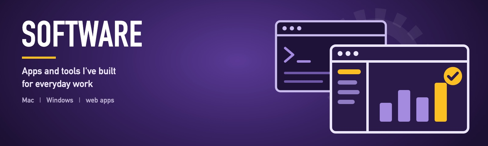

[← Back to my profile](https://github.com/gkaragioul)

<picture></picture>

Apps and tools I've built for everyday work. Every download is free, and every app has its own page with the install steps, what it does with your data, and help if something goes wrong.

## Mac apps

| | App | What it does | Download | Details |
|---|---|---|---|---|
|  | **Mac Disk Peek** | Shows the free space on every drive, from the menu bar | [⬇️ Mac](https://github.com/gkaragioul/mac-disk-peek/releases/latest/download/Mac-Disk-Peek-mac.dmg) | [App page](https://github.com/gkaragioul/mac-disk-peek) |
|  | **Mac Stickies** | Sticky notes that float on your desktop, from the menu bar | [⬇️ Mac](https://github.com/gkaragioul/mac-stickies/releases/latest/download/Mac-Stickies-mac.dmg) | [App page](https://github.com/gkaragioul/mac-stickies) |
|  | **iMovie Format Converter** | Turns any video into a file iMovie opens | [⬇️ Mac](https://github.com/gkaragioul/imovie-format-converter/releases/latest/download/iMovie-Format-Converter-mac.dmg) | [App page](https://github.com/gkaragioul/imovie-format-converter) |

## For Mac and Windows

| | App | What it does | Download | Details |
|---|---|---|---|---|
|  | **RDNA Cast** and **SiliconCast** | A lighter OBS Studio for recording and streaming games, using your graphics card's own encoder | [⬇️ Windows](https://github.com/gkaragioul/cast/releases/latest/download/RDNA-Cast-windows-setup.exe) · [⬇️ Mac](https://github.com/gkaragioul/cast/releases/latest/download/SiliconCast-mac.dmg) | [App page](https://github.com/gkaragioul/cast) |
|  | **Driftway Media Randomizer** | Shuffles the photos and videos in any folder, full window, one after another | [⬇️ Windows](https://github.com/gkaragioul/driftway-media-randomizer/releases/latest/download/Driftway-Media-Randomizer-windows-setup.exe) · [⬇️ Mac](https://github.com/gkaragioul/driftway-media-randomizer/releases/latest/download/Driftway-Media-Randomizer-mac.dmg) | [App page](https://github.com/gkaragioul/driftway-media-randomizer) |

More apps are being added to this list as each one is published.

## Licences

Most apps are MIT licensed: free to use, change and share. Apps built on someone else's open-source project keep that project's licence. RDNA Cast and SiliconCast, for example, are GPL like OBS Studio. Each app page says which applies.
